# Каталог косметики

Сначала — что сейчас в игре: рамки и рубашки с id, названием и видом. id —
то, по чему экраны берут рамку или рубашку (`FRAME_CATALOG.apply(el, id)`,
`BACK_CATALOG.html(id)`). Ниже — документация для разработки.

Таблицы и превью обновляет `node build/catalog-previews.cjs` (после любых
правок каталога). Превью — только для документации: в игре рамки и рубашки
рисуются CSS и SVG, картинок нет.

## Рамки в игре (30)

По макету Figma, раздел «Рамки» (`18162:84720`), на CSS и SVG.

<!-- catalog:frames -->
| id | Название | Вид | Узел Figma |
|---|---|---|---|
| `fr-01` | Серебро |  | 18162:84950 |
| `fr-02` | Апельсин |  | 18162:84978 |
| `fr-03` | Аметист |  | 18162:85008 |
| `fr-04` | Конфетти |  | 18162:84951 |
| `fr-05` | Лайм |  | 18162:84981 |
| `fr-06` | Северное сияние |  | 18162:85011 |
| `fr-07` | Закат |  | 18162:84954 |
| `fr-08` | Мандарин |  | 18162:84984 |
| `fr-09` | Лимон |  | 18162:85014 |
| `fr-10` | Фиалка |  | 18162:84957 |
| `fr-11` | Рассвет |  | 18162:84987 |
| `fr-12` | Полночь |  | 18162:85017 |
| `fr-13` | Вихрь |  | 18162:84960 |
| `fr-14` | Лазурь |  | 18162:84990 |
| `fr-15` | Лаванда |  | 18162:85020 |
| `fr-16` | Искры |  | 18162:84963 |
| `fr-17` | Звёздочки |  | 18162:84993 |
| `fr-18` | Малина |  | 18162:85023 |
| `fr-19` | Абрикос |  | 18162:84966 |
| `fr-20` | Лучи |  | 18162:84996 |
| `fr-21` | Рельеф |  | 18162:85026 |
| `fr-22` | Неон |  | 18162:84969 |
| `fr-23` | Фейерверк | 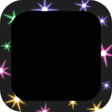 | 18162:84999 |
| `fr-24` | Пузыри | 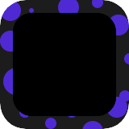 | 18162:85029 |
| `fr-25` | Далматин |  | 18162:84972 |
| `fr-26` | Снежинки | 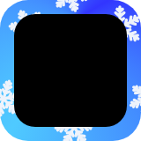 | 18162:85002 |
| `fr-27` | Волны |  | 18162:85032 |
| `fr-28` | Пастель |  | 18162:84975 |
| `fr-29` | Платина |  | 18162:85005 |
| `fr-30` | Горошек |  | 18162:85035 |
<!-- /catalog:frames -->

## Рубашки в игре (30)

По макету Figma, раздел «Рубашки» (`18036:39909`), перерисованы векторами (SVG).

<!-- catalog:backs -->
| id | Название | Вид | Узел Figma |
|---|---|---|---|
| `card-01` | Базовая | 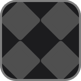 | 18036:78019 |
| `card-02` | Червячки | 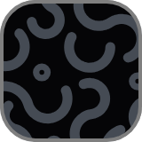 | 18036:78043 |
| `card-03` | Арлекин |  | 18047:78190 |
| `card-04` | Посыпка | 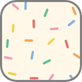 | 18047:78192 |
| `card-05` | Рельеф | 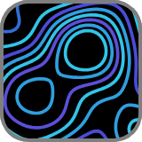 | 18047:78193 |
| `card-06` | Травы |  | 18047:78194 |
| `card-07` | Озорная |  | 18047:78195 |
| `card-08` | Мемфис | 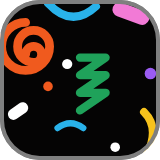 | 18047:78196 |
| `card-09` | Звёзды | 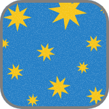 | 18047:78197 |
| `card-10` | Синева |  | 18047:78198 |
| `card-11` | Лабиринт | 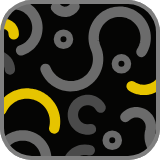 | 18047:78199 |
| `card-12` | Камуфляж | 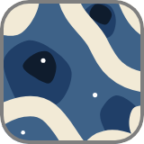 | 18047:78200 |
| `card-13` | Смайлы |  | 18047:78201 |
| `card-14` | Конфетти | 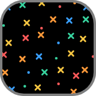 | 18047:78202 |
| `card-15` | Воронка | 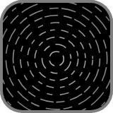 | 18047:78203 |
| `card-16` | Цветочки | 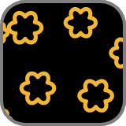 | 18047:78204 |
| `card-17` | Космос | 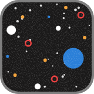 | 18047:78205 |
| `card-18` | Облака | 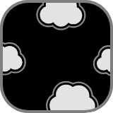 | 18047:78206 |
| `card-19` | Ромбы |  | 18047:78207 |
| `card-20` | Растр |  | 18047:78208 |
| `card-21` | Кристаллы | 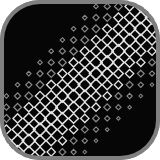 | 18047:78209 |
| `card-22` | Пиксели | 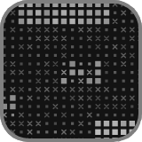 | 18047:78210 |
| `card-23` | Пламя | 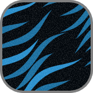 | 18047:78211 |
| `card-24` | Ацтек |  | 18047:78212 |
| `card-25` | Вспышка |  | 18047:78213 |
| `card-26` | Вертушка | 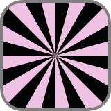 | 18047:78214 |
| `card-27` | Плитка | 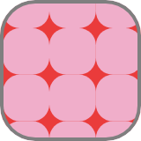 | 18047:78215 |
| `card-28` | Спираль | 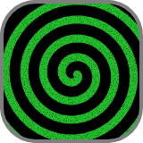 | 18047:78216 |
| `card-29` | Сетка | 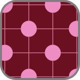 | 18047:78217 |
| `card-30` | Карнавал |  | 18047:78218 |
<!-- /catalog:backs -->

---

# Для разработки

Каталог — единственный источник **рамок аватара** и **рубашек колоды**.
Профиль, настройки профиля, поиск матча, матч (свой аватар, соперник,
профиль соперника), награды магазина и итога матча берут их по id.

**Сейчас в игре только обычная редкость:** 30 рамок и 30 рубашек по макету.
Редкие и эпические описаны и нарисованы, но выключены (`ACTIVE = ['basic']`
в `frames.js` и `backs.js`). Их будем включать в следующих версиях
постепенно: для этого достаточно дописать редкость в `ACTIVE`.

## Файлы

| Файл | Что внутри |
|---|---|
| `js/catalog/frames.js` | `FRAME_CATALOG`: рамки, отрисовка (SVG-узоры, заливки), `apply()` |
| `js/catalog/frames.figma.js` | `FRAMES_FIGMA`: 30 рамок по макету Figma (`fr-01…30`) на CSS и SVG — сейчас в игре |
| `js/catalog/frames.figma.data.js` | векторные данные рамок из Figma: SVG рамок и матрицы радиальных градиентов. Не править руками |
| `build/catalog-previews.cjs` | превью для этой документации: картинки рубашек и таблицы вверху |
| `js/catalog/frames.generated.js` | `FRAMES_GENERATED`: сгенерированные рамки. **Руками не править** |
| `build/gen-frames.mjs` | генератор рамок: `npm run gen:frames` |
| `js/catalog/backs.js` | `BACK_CATALOG`: рубашки, отрисовка фона и узора, `html()` |
| `js/catalog/backs.figma.js` | `BACKS_FIGMA`: 30 рубашек по макету Figma, перерисованные векторами (`card-01…30`) — сейчас в игре |
| `js/catalog/backs.generated.js` | `BACKS_GENERATED`: сгенерированные зимние рубашки (выключены). **Руками не править** |
| `build/gen-backs.mjs` | генератор рубашек: `npm run gen:backs` |
| `js/catalog/snowflake.js` | `SNOWFLAKE`: снежинки из параметров (узоры рубашек и новогодних рамок) |
| `js/catalog/motifs.js` | `MOTIFS`: зимние мотивы для рубашек (ёлка, подарок, игрушка, снеговик, звёзды) |
| `js/catalog/fx-emitter.js` | `FX_EMITTER`: эмиттер частиц (для редких и эпических, сейчас выключены) |
| `css/catalog/frames.css` | анимация редких рамок, облик эпических |
| `css/catalog/fx.css` | частицы, блик, общие `@keyframes`, `@property --fx-a` |
| `css/cosmetics24.css` | `.cb24`: рубашка (обычные — `.cb24-gen`, эпические — `.cb24-<id>`) |

Подключение: в `src/pages/<страница>.scripts.json` до `js/cosmetics24.js` идут
`snowflake.js`, `motifs.js`, `fx-emitter.js`, `frames.generated.js`, `frames.figma.data.js`, `frames.figma.js`, `frames.js`,
`backs.generated.js`, `backs.figma.js`, `backs.js`. Стили каталога подключаются в
`src/pages/<страница>.js` до `cosmetics24.css`. Сейчас каталог есть на
страницах `v2` и `match`. `js/cosmetics24.js` (`COSMETICS24`) — прокси к
каталогу для прежних вызовов (`frame`, `applyFrame`, `FRAMES`, `back`,
`backHTML`, `BACKS`).

## Рамки

```js
FRAME_CATALOG.get('basic-07')           // описание; неизвестный или выключенный id → «Белая»
FRAME_CATALOG.apply(el, 'basic-07')     // нарисовать рамку на элементе, вернёт описание
FRAME_CATALOG.random()                  // случайная из игровых (соперник в матче)
FRAME_CATALOG.random((f) => f.theme === 'ny')
FRAME_CATALOG.list                      // рамки в игре (30); all — все описанные
FRAME_CATALOG.css(id)                   // фон строкой (для подстановки в style)
```

**Элемент рамки.** Фон берётся из переменной: `background: var(--pf-frame)`,
толщину задаёт `padding`, внутри лежит картинка аватара. `apply()` сам ставит
переменную, а для редких и эпических ещё классы и частицы.

**Сейчас в игре — 30 рамок по макету Figma** (`fr-01…30`, раздел «Рамки»,
узел `18162:84720`). В макете рамка — квадрат 80×80: фон-кольцо 8px,
радиус 16, внутри чёрный квадрат 64×64 с радиусом 12. В игре всё нарисовано
CSS и SVG, без картинок. Фон рамки — строка CSS `background` в `--pf-frame`:

| Как сделан фон | Рамки |
|---|---|
| CSS `linear-gradient` из макета | 01, 29 (серебро), 04, 07, 21 |
| CSS `conic-gradient` (центр и угол пересчитаны из матрицы Figma) | 14, 16, 26 |
| цвет | 12, 15, 23 |
| SVG `radialGradient` с матрицей из Figma (`FRAMES_FIGMA_RADIAL`) | 02, 03, 05, 06, 08, 09, 10, 11 |
| вся рамка — вектор из Figma (`FRAMES_FIGMA_SVG`, числа округлены до 0,1) | 13, 17, 18, 19, 20, 22, 24, 25, 27, 28, 30; у 16 — узор «искры» поверх конического фона |
| узор поверх градиента перерисован векторно — в макете там растровые картинки | 04 конфетти, 07 ленточки (градиент от серого к белому, толщина 2,55–2,75), 10 снежная пыль, 21 изолинии, 23 искры, 26 снежинки |

Слой рисуется на весь элемент (`center / 100% 100%`). Кольцо в нём — 10%
стороны, а `padding` рамок на экранах — 6–8% (профиль 8/120, матч 4/64,
поиск 7/112). Поэтому аватар закрывает чёрную середину и часть кольца
изнутри: видимое кольцо такой же толщины, как раньше на этих экранах.

Перерисованные узоры (04, 07, 10, 21, 23, 26) повторяют характер и цвета
макета, но не пиксельно: искры в макете объёмные, у нас плоские со
свечением, снежинки проще по рисунку.

Особенности макета: рамки 01 «Серебро» и 29 «Платина» в макете одинаковые
(файлы совпадают). Названия рамок придуманы по виду: в макете узлы
называются номерами.

Выключены (описаны в `all`, `retired`): «Белая» и 9 прежних градиентов,
27 сгенерированных `frame-01…27`, новогодние `ny-ball` / `ny-snowflake`,
а также 10 редких `rare-01…10` и 6 эпических (`holo`, `plasma`, `royal`,
`flame`, `frost`, `void`). Сохранённый выбор выключенной рамки показывается
первой рамкой каталога (`fr-01`). Синонимы: `rainbow` → `holo`.

**Сгенерированные рамки (выключены).** Ниже — как они устроены.

**Приёмы обычных рамок** (`style`; фон рамки — слои CSS `background`, всё SVG в `data:`-URL):

| style | Что видно | Слои |
|---|---|---|
| `bold` | крупный узор (горошек, полосы, ромбы, волны…) | плитка 16–22 px |
| `micro` | мелкий узор: точки, штриховка, пинстрайп, сетка, клетка, плюсики | плитка 4–7 px |
| `grain` | градиент + зерно «как в печати» | шум `feTurbulence` 64 px |
| `studs` | «камушки» по сторонам: звёзды, ромбы, точки, плюсы (4 или 8 шт.), иногда поверх мелкого узора | по слою на камушек, `no-repeat` |
| `scallop` / `teeth` | фестоны / зубцы по внешнему краю | 4 слоя `repeat-x` / `repeat-y` |
| `stitch` | строчка-шов по краю | 4 слоя по краям |
| `split` | раскол цвета: пополам по диагонали или на четверти | `linear` / `conic` с жёсткими границами |
| `bands` | полосы 2–3 цветов | `repeating-linear-gradient` |

Заливка (`fill.type`): `solid`, `grad` (светлее → цвет → темнее через
`color-mix`), `duo` (основной → акцент), `split`, `quarters`, `bands`,
`bands3`. У части рамок поверх лёгкое зерно (`noise: { tone, amount }`; при отрисовке `amount` приглушается до 35%, зерно мелкое — как у рубашек).

```js
{
  id: 'frame-05', name: 'Мята', rarity: 'basic', style: 'grain',
  colors: ['#5fd3a8', '#e4fff3', '#14624a'],          // основной, второй, акцент
  fill: { type: 'grad', angle: 135 },
  deco: null,                                         // { kind: 'pattern'|'micro'|'studs'|'edge', … }
  noise: { tone: 'dark', amount: 0.65 },
}
```

Новогодние и выключенные рамки описаны по-старому: `fill` + `pattern` (узор
`snowflake` и др. из `FRAME_CATALOG.PATTERNS`).

**Генератор рамок** (`npm run gen:frames`) **дописывает** список до нужного
количества (`TARGET`) и не трогает уже выданные рамки. Новые получают
следующие номера и ещё не занятые палитры. Палитры (`FRAME_PALETTES`, по
имени палитры называется рамка), приёмы и их количество (`FRAME_PLAN`), а
также новогодние рамки (`NY_FRAMES`) задаются в начале
`build/gen-frames.mjs`.

## Рубашки

```js
BACK_CATALOG.get('card-07')     // описание; неизвестный id → первая
BACK_CATALOG.html('card-07')    // <span class="cb24 cb24-gen cb24-fig" style="--cb-bg:url(svg)">
BACK_CATALOG.svg(spec)          // SVG рубашки строкой
BACK_CATALOG.random()
BACK_CATALOG.list               // в игре (30); all — с выключенными эпическими
```

Рубашка — одна SVG-картинка 100×100, растянутая на весь носитель
(`position: absolute; inset: 0`). Поэтому одинаково выглядит в настройках
(99 px), в профиле (76 px), в поиске матча и в колоде матча (34 px). Кромка
(`--cb`) — светлый тон тёмного цвета фона.

**Сейчас в игре — 30 рубашек по макету Figma** (`card-01…30`, файл
`L9YY2OHqMbFIK7tqx1nuLJ`, раздел «Рубашки», узел `18036:39909`). Рамка как в
макете: квадрат, фон `#1c1c1e`, обводка 2px `#7f7f7f` (`--cb-rim`), радиус
25% (20 из 80) — класс `.cb24-fig`. В макете, кроме «Базовой», узоры — растровые
картинки. Здесь каждая перерисована векторами: функция `draw(h)` в
`js/catalog/backs.figma.js` возвращает SVG 100×100. Помощники
`BACK_FIGMA_HELPERS`: прямоугольник, круг, кольцо, многоугольник, линия,
звезда, ромб, клякса, ГПСЧ, зерно, `worms` (червячки без касаний), `jitter` (равномерный разброс), `contours` (изолинии поля высот). Узел Figma каждой рубашки — в поле `node`.

| id | Название | Что нарисовано |
|---|---|---|
| card-01 | Базовая | шахматка серых ромбов на #1c1c1e (векторная в макете) |
| card-02 | Червячки | серые дуги, S-образные червячки и колечки на чёрном; фигуры не касаются друг друга (раскладка с проверкой расстояния) |
| card-03 | Арлекин | колонки красных и шалфейных ромбов через четверть ширины, звёзды посередине кремовых промежутков |
| card-04 | Посыпка | крупные цветные палочки на кремовом, разбросаны равномерно (сетка 4×5 со сдвигом) |
| card-05 | Рельеф | толстые изолинии трёх холмов (линии уровня одного поля — не пересекаются) |
| card-06 | Травы | как в макете: две группы зелёных наклонных волн, жёлтые и бирюзовые волны справа; группы не касаются, без обрывков у края |
| card-07 | Озорная | звёзды, волна, зигзаг, цветок, кляксы на белом |
| card-08 | Мемфис | спираль, дуги, капсулы, зигзаг на чёрном |
| card-09 | Звёзды | жёлтые восьмилучевые звёзды на синем с зерном |
| card-10 | Синева | толстые синие извилины на кремовом |
| card-11 | Лабиринт | серые и жёлтые извилины без пересечений |
| card-12 | Камуфляж | синяя основа, широкие кремовые извилистые ленты, тёмные пятна |
| card-13 | Смайлы | крупные цветные круги без лиц (композиция чуть «отдалена») |
| card-14 | Конфетти | крупные цветные крестики и точки, равномерно (сетка 6×6 со сдвигом) |
| card-15 | Воронка | концентрические пунктирные кольца |
| card-16 | Цветочки | жёлтые контурные цветы на чёрном |
| card-17 | Космос | точки, кольца и большая синяя планета на тёмном с зерном |
| card-18 | Облака | белые облака с двойным контуром на чёрном |
| card-19 | Ромбы | ромбы встык с растровой заливкой (5 уровней яркости), плавно гаснут сверху вниз, часть тёмные |
| card-20 | Растр | диагональная полоса растровых точек |
| card-21 | Кристаллы | контурные ромбы разного размера по диагонали |
| card-22 | Пиксели | крупная сетка крестиков и квадратиков, светлые прямоугольные пятна |
| card-23 | Пламя | синие волнистые полосы «зебры» по диагонали, зерно |
| card-24 | Ацтек | пиксельная решётка тёмно-синих ромбов на розовом |
| card-25 | Вспышка | чёрные лучи на белом, звезда в центре |
| card-26 | Вертушка | чёрные и розовые лучи из центра |
| card-27 | Плитка | розовые скруглённые квадраты, между углами — красные звёзды |
| card-28 | Спираль | зелёная спираль на чёрном с зерном |
| card-29 | Сетка | бордовый фон, розовая сетка, круги в узлах |
| card-30 | Карнавал | ромбы оранжевого, красного, розового и кремового, искры |

Рубашки сравнивались с макетом при 80×80 (скриншоты рядом). Осознанные
отличия: узоры повторяют облик и цвета картинок, но это не пиксельные копии
(расположение элементов в рандомных узорах своё); в «Смайлах» лица убраны по просьбе; у «Базовой» стороны ромбов
прямые со скруглёнными углами, в макете — слегка выпуклые.

Выключены (`retired`, код сохранён): 30 зимних рубашек из генератора и
6 эпических.

**Зимние рубашки (выключены)** (`winter-01…30`), восемь видов композиции (`style`).
Все нарисованы «близким планом»: фигуры крупные и их немного, без мелких
деталей, чтобы рубашка читалась и на колоде в матче (34 px).

| style | Что нарисовано | Сколько |
|---|---|---|
| `tile` | сетка мотивов в шахматном порядке, 2 в ряд (ёлки, подарки, игрушки, снеговики, звёзды, снежинки) | 5 |
| `knit` | «свитер»: крупный фрагмент (×2.5) — 2–3 полосы зубцов, точек, клеток, крестиков и мотивов | 4 |
| `poster` | пейзаж: крупная луна у края, 2–3 большие ёлки на холме, сугробы, снег | 4 |
| `folk` | народная открытка: кайма с фестонами или зубцами, звёзды в углах, крупный мотив в середине (ёлка, подарок, снежинка, звезда) | 4 |
| `big` | крупная форма, у каждой своя (`sub`): `tree` — гигантская ёлка во весь рост с игрушками, `balls` — горка огромных снежков и летящие снежки, `slope` — склон горки с лыжнёй и солнцем | 3 |
| `garland` | одна провисающая гирлянда с 3–4 крупными игрушками или звездой | 3 |
| `snowfall` | снегопад: 4–5 очень крупных снежинок разных форм | 3 |
| `geo` | абстракция: три толстые волны с косой чертой, ступени, ромбы, крупные стежки-крестики, арки | 4 |

**Цвета** — 14 зимних палитр (красная, хвоя, ночь, лёд, ёлочный шар,
ягода, горчица, бирюза, барвинок, крем, фуксия, лайм, чёрное с золотом,
вино). Фон — цвет или градиент, у части рубашек шум «как в печати».

```js
{
  id: 'winter-07', name: 'Ельник', rarity: 'basic', style: 'tile',
  pal: { bg: ['#b0124a', '#6e0b31'], ink: '#ffd9e6', accent: '#ff8fb1', accent2: '#ffffff' },
  grad: 135,                  // угол градиента фона или null — сплошной
  noise: 'light',             // зерно: light | dark | null
  seed: 123456,               // зерно раскладки внутри вида
  motifs: ['tree'], variant: 2, n: 3, dots: true,   // параметры вида
  sub: 'zig',                 // подвид (folk, big, geo)
}
```

**Мотивы** (`js/catalog/motifs.js`, `MOTIFS`) — простые плоские фигуры в
поле 100×100: `tree` (4 варианта), `gift`, `ornament`, `snowman`, `star`,
`star8`, `diamond`, `snowflake`, `dot`.

**Снежинка** (`SNOWFLAKE.svg(spec, { x, y, r, rot, ink })`) — шесть
одинаковых лучей. Параметры: `branches` — веточки `[место на луче 0…1,
длина, угол]`, `tip` — кончик (`none`, `fork`, `diamond`, `arrow`, `bar`),
`core` — середина (`none`, `hex`, `hexfill`, `star`), `width` — толщина.
`SNOWFLAKE.EVENT` — снежинка с иконки ивента.

**Генератор рубашек** (`npm run gen:backs`, зерно `--seed N`) собирает
30 рубашек заново по плану `PLAN` (вид, количество, имена, подвиды) и
палитрам `PALETTES`. Соседние рубашки — разного вида и цвета. Раскладка
внутри вида считается при отрисовке из `seed`: если поменять код вида в
`backs.js`, облик рубашек с этим видом тоже поменяется.

## Эмиттер частиц (`js/catalog/fx-emitter.js`)

Нужен редким и эпическим (сейчас выключены). Частицы сделаны без canvas:
каждая частица — элемент `<i data-fx>` внутри носителя (`position: relative`),
движение задаёт CSS-анимация из `css/catalog/fx.css`. Эмиттер только
расставляет частицы: место, задержку, размер и цвет. Разброс
псевдослучайный, поэтому при каждой отрисовке одинаковый.

```js
FX_EMITTER.html(kind, count, { color, seed })   // HTML-строка частиц
FX_EMITTER.emit(el, kind, count, opts)          // вставить в элемент
FX_EMITTER.clear(el)                            // убрать свои частицы
```

| Вид | Класс | Поведение | Цвет |
|---|---|---|---|
| `spark` | `.fx-sp` | звёздочка вспыхивает в одной из 8 точек периметра | `--spark` |
| `ember` | `.fx-em` | уголёк поднимается от нижнего края | `--fx-c`, свечение `--fx-glow` |
| `star` | `.fx-st` | точка мерцает в случайном месте | `--fx-c` |

Новый вид частиц: функция в `KINDS` плюс класс и `@keyframes` в
`css/catalog/fx.css`. При «уменьшении движения» анимации выключаются.

## Где используется

| Экран | Код |
|---|---|
| Профиль и настройки профиля, версия 2 (секции по редкости; сейчас одна — «Обычные») | `js/profile24.js` |
| Профиль и настройки, версия 3 (рамки из каталога) | `js/v3.js` |
| Поиск соперника (свой аватар, соперник, колоды) | `js/matchmaking24.js` |
| Матч: шапка, колоды, карты рубашкой вверх, профиль соперника | `js/match24.js`, `js/match.js` |
| Награда магазина «Оформление» (любая рамка или рубашка каталога) | `js/shop.js` |
| Подарок в итоге матча, версия 3 (обычная рамка) | `js/match-result3.js` |

Соперник в версии 2 получает случайную рамку из каталога, одну на матч
(`MATCH24.oppFrame`), и первую рубашку каталога (`MATCH24.oppBack`). В версии 3
соперник остаётся с красной рамкой.
